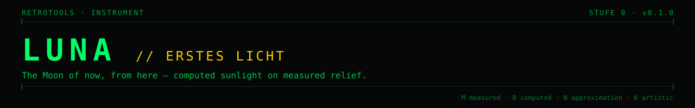
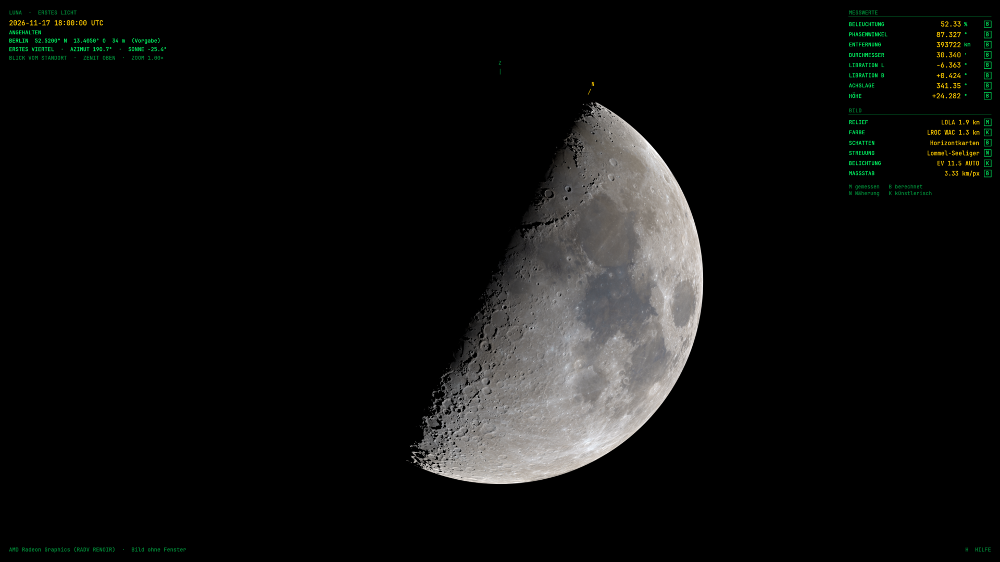
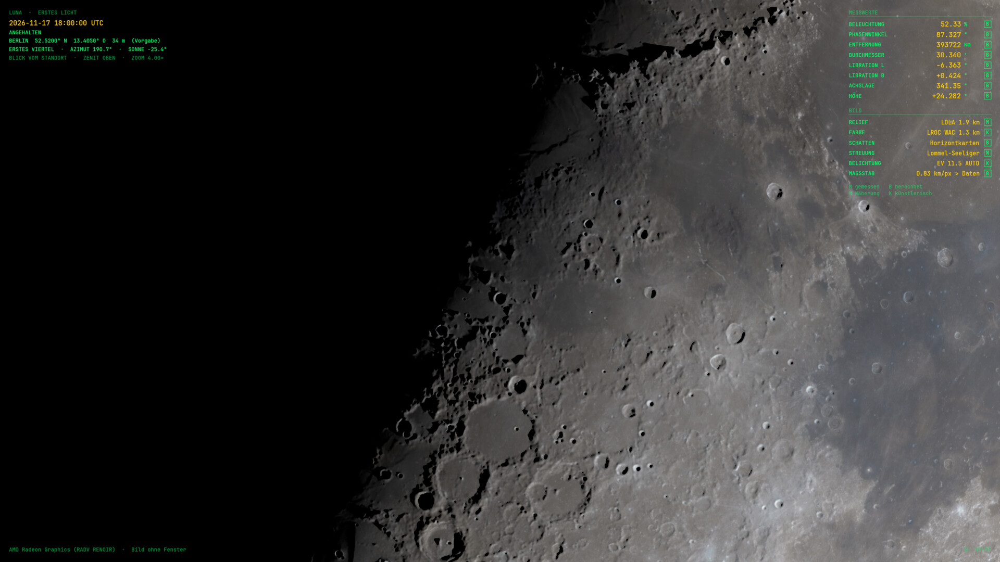
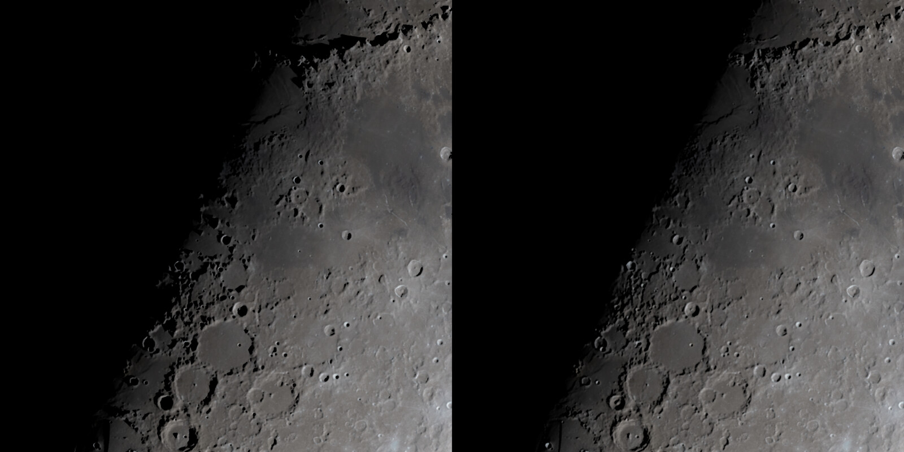
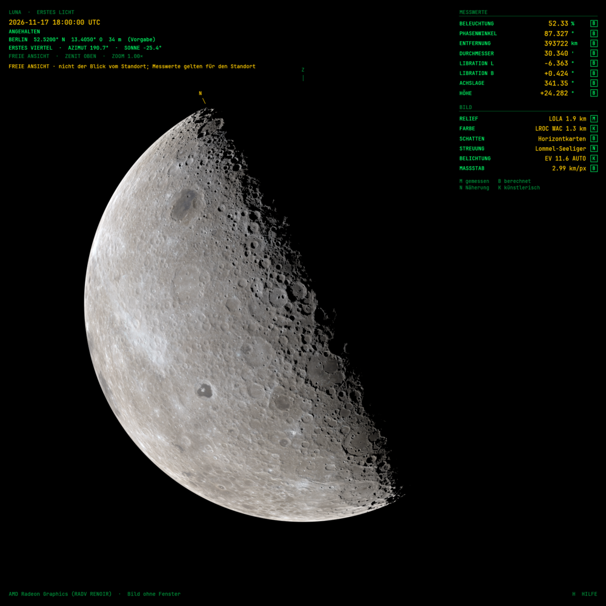
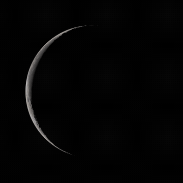

<p align="center">
  
</p>

**LUNA** shows the Moon as it is *right now*, seen from *your place on Earth* — with sunlight computed
from JPL ephemerides falling on the measured lunar relief. The phase is not a texture: it appears
because the Sun stands where the ephemeris puts it, and the LOLA elevation model casts the shadows.

LUNA is an instrument, not a planetarium. Every displayed quantity carries its provenance:

| Tag | Meaning | In this release |
| --- | --- | --- |
| **M** measured | instrument data | LRO/LOLA elevation model |
| **B** computed | ephemerides and geometry | phase, libration, distance, axis, cast shadows |
| **N** approximation | model with a known limit | regolith scattering, Earth rotation outside the measured series |
| **K** artistic | design without a measurement claim | colour map, exposure |

> **Release status:** `v0.1.0` · Stage 0 prototype *„Erstes Licht“* · Linux + Vulkan · source release.
> The user interface and command line are in **German**.

<p align="center">
  
  <br><sub>Real output of <code>luna --render … --at 2026-11-17T18:00 --hud</code> — default site Berlin, no retouching.</sub>
</p>

## What it does

- **Computes the sky geometry** with [ANISE](https://github.com/nyx-space/anise) on JPL DE440 kernels:
  topocentric position, illuminated fraction, phase angle, distance, apparent diameter,
  optical libration, position angle of the axis, altitude and azimuth — in 64-bit.
- **Renders the Moon on the GPU** (wgpu / Vulkan): per-pixel ray against the lunar sphere,
  surface slopes from LOLA, cast shadows from precomputed horizon maps in eight directions
  (≈ 250 km reach, curvature included), penumbra from the solar diameter,
  Lommel-Seeliger scattering with a phase function fitted to Allen's lunar brightness curve,
  and a camera-style exposure (EV at ISO 100).
- **Checks itself.** `luna --verify` verifies data checksums, the computation chain against frozen
  JPL Horizons values, map orientation and the rendered image (see [Testing](#testing)).
- **Writes receipts.** `luna --render` and the `S` key save PNGs whose metadata records time,
  site, view and the checksums of every kernel and map used.
- **Fits tiling desktops.** The instrument column adapts to the window size, follows the running
  Omarchy theme colours when present, and is fully keyboard-operable.

| Terminator at 4× zoom | Cast shadows on / off |
| --- | --- |
|  |  |

| Free view over the far side | One lunation (48 frames, Moon-north up) |
| --- | --- |
|  |  |

All images are unedited LUNA renders (`--render`) made with this release on an AMD Radeon (RADV) GPU.
The colours of the instrument column come from the RetroTools *Phosphor & Sulfur* palette
(`#00FF66` / `#FFCC00`) supplied as a theme file; without a theme LUNA uses its built-in colours.

## Requirements

| | |
| --- | --- |
| OS | Linux, Wayland or X11 (developed and tested on Arch Linux / Hyprland) |
| GPU | Vulkan driver (e.g. Mesa RADV/ANV, NVIDIA). Other wgpu backends are not enabled. |
| Toolchain | Rust **1.93** or newer (`rustup`) and a C compiler (`cc`, used by a build script of `wayland-backend`) |
| Tools | `bash`, `curl`, `sha256sum` for the data download; `fc-match` (fontconfig) optional |
| Disk | ≈ 0.32 GB source data + ≈ 0.43 GB prepared maps + build directory |
| GPU memory | ≈ 450 MB for the maps |

macOS and Windows are not supported in this release.

## Quickstart

```sh
git clone <this repository> luna && cd luna
./scripts/fetch-data.sh                 # one-time ≈ 0.3 GB from NASA SVS and JPL NAIF → data/raw
cargo build --release --locked
./target/release/luna-forge             # prepares the maps (≈ 1 min) → data/forged, data/manifest.json
./target/release/luna --verify          # self-test
./target/release/luna                   # window
```

After this LUNA needs no network. Everything stays inside the project folder and the user's Cargo
directory; nothing is installed system-wide. **Uninstall** = delete the folder
(plus `~/.config/luna/` and `~/Pictures/LUNA/` if you created them).

`fetch-data.sh` pins the SHA-256 of every immutable source file and aborts on any mismatch.
`earth_latest_high_prec.bpc` is updated daily by JPL; its checksum is recorded on download and then
fixed in `data/manifest.json`, which LUNA checks on every start.

## Usage

```sh
luna                                         # now, from the configured site
luna --lat 48.137 --lon 11.575 --height 520  # another site
luna --at 2026-11-24T18:30:00                # another time (UTC)
luna --render bild.png --at 2026-11-17T18:00 --size 2560x1440 [--hud --scale 1.25]
luna --info                                  # readings as text
luna --verify                                # self-test
luna --bench                                 # performance measurement as JSON
luna --help
```

A permanent site lives in `~/.config/luna/config.toml` (respects `XDG_CONFIG_HOME`):

```toml
lat = 52.52
lon = 13.405
height = 34
name = "Berlin"
```

Without this file LUNA uses Berlin and says so in the display (`(Vorgabe)`).
`LUNA_DATA` points to a data folder elsewhere; `LUNA_ADAPTER` picks a GPU by part of its name.

### Keys

| Input | Effect |
| --- | --- |
| Mouse wheel | scrub time, 20 min per notch (Shift: 1 day) |
| Ctrl + wheel, `+` / `-` | zoom |
| Drag (left button) | rotate the globe (free view, including the far side) |
| Double-click, `Home` | back to the view from the site |
| `→` / `←` | time-lapse faster / slower, also backwards (1 min/s … 30 d/s) |
| `Space` | pause / resume |
| `N` | now, real time |
| `E` / Shift + `E` | exposure ±1/3 stop · `A` auto exposure |
| `O` | orientation: zenith up, celestial north up, lunar north up |
| `R` | image: full, without cast shadows, smooth sphere |
| `S` | save PNG receipt to `~/Pictures/LUNA` |
| `H`, `F1` | help · `Q` quit |

Hovering a row of the measurement column shows its source and error bound in the footer.

## Architecture

| Crate | Role |
| --- | --- |
| `crates/luna-core` | time scales, ephemerides (ANISE), reference frames, observer, scene state, verification of the computation chain. Pure 64-bit computation. |
| `crates/luna-data` | `.lmap` map format, manifest, checksums |
| `crates/luna-forge` | prepares the source files: slopes and horizon maps from the elevation model, mip chains |
| `crates/luna-render` | image formation with wgpu on Vulkan: camera, scattering, cast shadows, exposure |
| `crates/luna-ui` | instrument layer; knows only the finished display model |
| `crates/luna` | program: window, command line, image output, verification |

Positions stay in 64-bit and are reduced to 32-bit only relative to the camera.

## Testing

`cargo test --release --locked` and `luna --verify` check, on real data and a real GPU:

- **Data:** SHA-256 of all files against the manifest (also on every start).
- **Computation chain:** 14 quantities at 50 epochs (2001–2026) and 3 public observatories
  (Greenwich, Mauna Kea, Sydney) against frozen JPL Horizons output in `reference/horizons`.
  Tolerances: position ≤ 1″, distance ≤ 1 km, illumination ≤ 0.01 percentage points,
  angles ≤ 0.01°. Eight further epochs 1905–2031 exercise the Earth-rotation fallback (reported only).
- **Map orientation:** highest point of the Moon, three craters in the elevation model and three dark
  crater floors in the colour map, each against its east-west mirror image.
- **Image:** Apollo 11/15/17 and three craters land on the expected pixel (zoom 1 and 6); full Moon
  without limb darkening; cast shadows present; the same command yields a byte-identical image.
- **Input handling:** invalid times, sites and non-finite numbers are rejected with a clear message.

Results for this release are in [`docs/TEST_REPORT.md`](docs/TEST_REPORT.md).
Not automated: comparison with own photographs, a second computation path, glyph sharpness and idle
load in the live window.

## Privacy and security

- **No network at runtime.** Only `scripts/fetch-data.sh` (NASA/JPL, HTTPS) and the developer script
  `scripts/fetch-horizons.sh` (JPL Horizons, public observatory coordinates only) go online.
- **Your location stays local.** It is read from the command line or `~/.config/luna/config.toml`.
  It is, however, **written into the metadata of every PNG** LUNA saves (`LUNA:Standort`, as part of
  the receipt) and shown in the HUD. Strip metadata or use a public site before sharing images.
- LUNA reads `colors.toml` of the current Omarchy theme (if present) and calls `fc-match monospace`
  to pick a system font. It writes only the PNG files you request, `~/Pictures/LUNA/` (`S` key),
  and — through `luna-forge` — `data/forged/` and `data/manifest.json`.
- No telemetry, no accounts, no secrets. See [`SECURITY.md`](SECURITY.md) for reporting issues.

## Known limitations

- The limb is a smooth sphere; mountains do not yet show on the edge of the disc.
- Shadow edges are as fine as the elevation model (1.9 km). LUNA invents no detail when zooming in;
  the `MASSSTAB` row says when the image is finer than the data.
- Horizon maps know eight directions, interpolated linearly in between.
- No earthshine, no stars, no eclipses — during a lunar eclipse the prototype shows a normal full Moon.
- Outside the measured Earth-rotation series (currently 2000 – Feb 2027) a model is used and the display
  says so. Before 1972 the entered time is treated as UT1. Valid range: DE440s, 1849–2150.
- The clock shows UTC, not local time. UI and CLI are German only.
- Linux + Vulkan only; tested on one GPU (AMD Radeon / Mesa RADV). Other GPUs are untested.
- wgpu 29 / egui 0.35 are used because newer versions require Rust 1.95.

## Data and credits

LUNA ships **no third-party data**. `scripts/fetch-data.sh` downloads it from the source:

| File | Content | Source |
| --- | --- | --- |
| `ldem_16_uint.tif` | LOLA elevation, 16 px/° | CGI Moon Kit, NASA's Scientific Visualization Studio; LRO/LOLA |
| `lroc_color_16bit_srgb_8k.tif` | colour map 8k (2025 edition) | CGI Moon Kit, NASA's Scientific Visualization Studio; LRO/LROC |
| `de440s.bsp` | positions of Sun, Earth, Moon | NASA/JPL, DE440 (Park et al. 2021) |
| `moon_pa_de440_200625.bpc` | lunar orientation | NASA/JPL NAIF |
| `earth_latest_high_prec.bpc` | Earth orientation, measured and predicted | NASA/JPL NAIF |
| `pck00011.tpc`, `moon_de440_250416.tf` | body constants, frames | NASA/JPL NAIF |

The colour map is, in NASA's words, "optimized for aesthetics, not science" and therefore tagged **K**.
The reference values in `reference/horizons/` are output of the
[JPL Horizons System](https://ssd.jpl.nasa.gov/horizons/). LUNA is not affiliated with or endorsed by
NASA or JPL and uses no NASA insignia. Third-party software licences: [`THIRD_PARTY_NOTICES.md`](THIRD_PARTY_NOTICES.md).

## License

[MIT](LICENSE) © 2026 K3RN — applies to the LUNA source code, scripts, documentation and the
showcase images in `docs/media/` (which depict NASA-derived data, see above).
